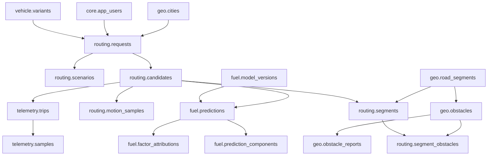

# سند معماری پایگاه‌داده تخمین مصرف بنزین پراید در تهران

**نسخه:** ۱.۰ — ۱۴ آبان ۱۴۰۵ / 2026-11-05  
**پایگاه‌داده:** PostgreSQL 15+ / PostGIS 3+  
**وضعیت:** طرح اولیه قابل توسعه؛ هنوز با داده میدانی پراید کالیبره نشده است.

## ۱. هدف و فرض‌های مهم

- خودرو: فعلاً خانواده پراید؛ در داده اولیه فقط شناسه تیپ **پراید ۱۳۱ دنده‌دستی** ثبت شده است. مشخصات مکانیکی و ضرایب مصرف باید از سند معتبر یا اندازه‌گیری وارد شوند. مقدار `NULL` یعنی مجهول، نه صفر.
- مکان: شهر تهران. حد جغرافیایی واقعی باید به `geo.cities.boundary` وارد شود؛ درج شناسه شهر به‌تنهایی محدوده واقعی را مشخص نمی‌کند.
- دو حالت: **پیش‌بینی قبل از سفر** و **سفر واقعی برای کالیبراسیون**. ورودی‌های آینده‌نگر با داده‌هایی که فقط پس از رانندگی معلوم می‌شوند اشتباه گرفته نمی‌شوند.
- همه مسیرها از EPSG:4326 استفاده می‌کنند: ذخیره هندسه با `geometry(Point/LineString,4326)`؛ اندازه‌گیری فاصله در متر با `::geography` یا تصویر مناسب محلی انجام شود. ترتیب مختصات `longitude, latitude` است.
- مصرف گزارش‌شده بر حسب `L/trip` و `L/100km` است. سرعت حرکت: `m/s` در پروفایل زمانی و `km/h` در ورودی‌های کاربر/راه.
- منبع، نسخه و کیفیت اطلاعات باید ثبت شوند؛ برآورد فاقد منبع یا با ضرایب فرضی «کالیبره» تلقی نشود.

## ۲. ساختار فیزیکی: ۲۷ جدول / ۷ Schema

| Schema | جدول‌ها | وظیفه |
|---|---|---|
| `core` | `app_users`, `data_sources`, `ingestion_batches`, `factor_catalog` | شناسه کاربر، منبع، نسخه واردسازی، فرهنگ عوامل |
| `geo` | `cities`, `road_segments`, `elevation_samples`, `obstacles`, `obstacle_reports`, `traffic_profiles`, `weather_observations` | شبکه خیابان، شیب، موانع، ترافیک و هوا |
| `vehicle` | `variants`, `instances`, `maintenance_events` | مشخصات پایه پراید، نمونه واقعی و وضعیت نگهداری |
| `routing` | `requests`, `scenarios`, `candidates`, `segments`, `motion_samples`, `segment_obstacles` | درخواست، شرایط سفر، مسیرها، قطعات، حرکت پیش‌بینی‌شده، موانع مسیر |
| `fuel` | `model_versions`, `predictions`, `prediction_components`, `factor_attributions` | نسخه علمی الگوریتم، مصرف و تبیین نتایج |
| `telemetry` | `trips`, `samples` | داده‌های واقعی آزمایش و OBD/GPS |
| `ops` | `audit_events` | تاریخچه اصلاحات مدیر و عملیات حساس |

### روابط اصلی



### چه چیزی در کدام لایه ذخیره می‌شود؟

1. **ثابت‌های خودرو:** `vehicle.variants`. نمونه: جرم پایه، Cd، سطح جلو، مصرف مرجع؛ فقط پس از اعتبارسنجی.
2. **وضعیت یک پراید مشخص:** `vehicle.instances` و `vehicle.maintenance_events`. نمونه: سال ساخت، کیلومتر، سابقه تعمیر.
3. **فرض‌های یک سفر:** `routing.scenarios`. نمونه: وزن اضافه، کولر، استارت سرد، فشار باد، هوا. هنگام پیش‌بینی باید به‌عنوان snapshot تغییرناپذیر ثبت شوند.
4. **داده‌های نسبتاً ثابت راه:** `geo.road_segments`, `geo.elevation_samples`, `geo.obstacles`.
5. **داده‌های وابسته به ساعت یا تاریخ:** `geo.traffic_profiles`, `geo.weather_observations`, `routing.requests.planned_departure_at`.
6. **ویژگی‌های استخراجی هر مسیر:** `routing.segments`, `routing.segment_obstacles`.
7. **سرعت و شتاب شبیه‌سازی‌شده:** `routing.motion_samples`، در گام‌های زمانی قابل تنظیم (مثلاً ۱ ثانیه).
8. **محاسبه و مدل:** `fuel.model_versions`, `fuel.predictions` و جداول توضیحی.
9. **واقعیت اندازه‌گیری‌شده:** `telemetry.trips`, `telemetry.samples` (نه با پیش‌بینی‌ها در یک جدول).

## ۳. عوامل مؤثر بر مصرف و نحوه مدل‌سازی

### ۳.۱ راه و هندسه

- **طول و مسافت واقعی مسیر:** ورودی محاسبه کار انجام‌شده و مدت حرکت؛ `routing.candidates.length_m` و `routing.segments.distance_m`.
- **شیب، ارتفاع‌گیری و سرازیری:** در نیروی گرانش و توان محرکه ظاهر می‌شود؛ `geo.elevation_samples`, `routing.segments.mean_grade_pct`, `ascent_m`, `descent_m`. مثبت‌بودن شیب الزاماً به افزایش مصرف در یک جاده مشخص نسبت به هر جاده دیگر قابل جمع ساده نیست؛ حرکت سرازیری می‌تواند قطع پاشش و ترمز موتوری داشته باشد.
- **نوع جاده و محدودیت سرعت:** بزرگراه، خیابان اصلی، محلی؛ مؤثر بر سرعت و رخداد توقف، نه خودکار یک ضریب ثابت سوخت؛ `geo.road_segments.road_class`, `maxspeed_kph`.
- **کیفیت روسازی، چاله و مصالح جاده:** تغییر مقاومت غلتشی، سرعت و الگوی ترمز/شتاب؛ `surface`, `smoothness`, obstacles.
- **تعداد پیچ، انحنا و گردش‌ها:** نرخ کاهش سرعت و شتاب‌گیری؛ حاصل از هندسه `LineString` و راهنمای مسیریابی؛ قابل درج در `fuel.predictions.feature_snapshot` و بعداً ستون استخراجی مخصوص.
- **تعداد خطوط، یک‌طرفه بودن، بسته بودن مسیر، تنگ‌شدگی:** اثر بیشتر از طریق مسیر و ترافیک؛ `directionality`, `lanes` و عوارض شبکه. داده بسته‌شدن مسیر لحظه‌ای نیازمند سرویس مستقل است.

### ۳.۲ موانع و ترافیک

- چراغ راهنمایی: شمارش تنها کافی نیست؛ احتمال قرمز، طول چرخه، طول صف، هماهنگی چراغ‌ها و مدت توقف لازم است.
- سرعت‌گیر: سرعت ورودی و عبوری، شکل/ارتفاع واقعی و شتاب‌گیری پس از عبور؛ «بنزین ثابت برای هر سرعت‌گیر» مدل مناسبی نیست.
- تابلو ایست و حق تقدم، میدان، تقاطع با عابر یا راه‌آهن، پروژه عمرانی، چاله، تنگی راه: بسته به رفتار واقعی ممکن است توقف یا کاهش سرعت ایجاد کنند.
- دوربین سرعت: عامل مستقیم نیروی مقاومت نیست؛ تنها از مسیر تغییر رفتار راننده می‌تواند مؤثر شود.
- ازدحام: زمان صف، سرعت جریان، تراکم توقف و حرکت، زمان سفر، ساعت و روز هفته، هم‌پوشانی با تأخیر چراغ‌ها. داده سراسری ترافیک زنده از OSM به‌طور مستقل به دست نمی‌آید.
- تطبیق مانع: فاصله هندسی تنها کافی نیست؛ باید تعلق به همان یال خیابان، جهت حرکت، تقاطع و هندسه پل/زیرگذر بررسی شود.

### ۳.۳ خودرو و وضعیت فنی

- جرم بدنه، مسافران، بار، مقدار بنزین (با دقت به تعریف جرم خالی) و اینرسی دورانی.
- Cd، سطح جلو، مقاومت غلتشی و بازده گیربکس.
- منحنی بازده موتور/BSFC در دور و گشتاور مختلف؛ RPM، دنده، نسبت‌های گیربکس، زاویه دریچه گاز و بار موتور.
- مصرف درجا، استارت سرد، مدت توقف موتور پیش از سفر و دمای آب موتور.
- فشار باد و نوع لاستیک، ساییدگی، تنظیم فرمان، گیرکردگی ترمز، مقاومت بلبرینگ.
- وضعیت شمع‌ها، انژکتور، فیلتر هوا و روغن، روغن مناسب، اکسیژن‌سنسور/لامبدا، سیستم سوخت، گرفتگی اگزوز و تنظیم موتور. برخی تنها با معاینه/حسگر قابل استنتاج‌اند.
- کولر و سیکل کمپرسور، بخارگیر، دینام و تجهیزات برقی، باز بودن شیشه‌ها و بار روی سقف. اثر بار سقف در MVP ورودی جداگانه ندارد و می‌تواند در پارامترهای آیرودینامیکی مدل نسخه بعد بیاید.

### ۳.۴ شرایط بیرونی و راننده

- دما، فشار هوا، چگالی هوا، رطوبت، جهت و سرعت نسبی باد، باران، خیسی/برف روی راه، سطح لغزنده، ارتفاع.
- سبک رانندگی، تمایل به شتاب‌گیری، دنده و زمان تعویض آن، فاصله با خودروی جلو، استفاده از کولر یا شیشه و رفتار هنگام ترمز.
- کیفیت سوخت و ارزش حرارتی، تغییر ترکیب بنزین و شرایط احتراق؛ صرفاً در صورت داده معتبر قابل مدل‌سازی است.

### کاتالوگ 94 عاملی

برای هر عامل یک شناسه ثابت، گروه، واحد، منبع احتمالی و زمان اضافه‌شدن تعریف شده است. فهرست زیر مستقیماً با seed فایل SQL هماهنگ است. `mvp` به معنای *اولویت مدل‌سازی* است، نه تضمین موجود بودن داده در تهران. «عمدتاً» به معنای قانون قطعی نیست و باید با شرایط عملیاتی سنجیده شود.

| شناسه متغیر | عنوان | واحد | اثر | منبع احتمالی | فاز |
|---|---|---|---|---|---|
| `distance_m` | مسافت مسیر | m | عمدتاً افزایش | محاسباتی | MVP |
| `road_bearing_deg` | جهت حرکت نسبت به شمال | degree | وابسته به شرایط | محاسباتی | بعدی |
| `intersection_density` | تراکم تقاطع | count/km | غیرمستقیم | محاسباتی | بعدی |
| `road_closure` | محدودیت/بسته بودن راه | boolean | غیرمستقیم | سرویس/مرجع | بعدی |
| `route_curvature` | انحنای مسیر | 1/m | وابسته به شرایط | محاسباتی | بعدی |
| `turn_count` | تعداد گردش‌های مسیر | count | وابسته به شرایط | محاسباتی | بعدی |
| `slope_pct` | شیب طولی مسیر | % | وابسته به شرایط | محاسباتی | MVP |
| `ascent_m` | ارتفاع‌گیری تجمعی | m | عمدتاً افزایش | محاسباتی | MVP |
| `descent_m` | کاهش ارتفاع | m | وابسته به شرایط | محاسباتی | MVP |
| `road_class` | رده راه | — | غیرمستقیم | نقشه OSM | MVP |
| `speed_limit_kph` | حداکثر سرعت | km/h | وابسته به شرایط | نقشه OSM | MVP |
| `surface` | نوع روسازی | — | وابسته به شرایط | نقشه OSM | MVP |
| `smoothness` | همواری و کیفیت سطح | — | وابسته به شرایط | نقشه OSM | بعدی |
| `lanes` | تعداد خط عبور | count | غیرمستقیم | نقشه OSM | بعدی |
| `junction_density` | تراکم تقاطع | count/km | غیرمستقیم | محاسباتی | بعدی |
| `rail_crossing_count` | تعداد تقاطع با راه‌آهن | count | وابسته به شرایط | نقشه OSM | بعدی |
| `road_narrowing_count` | تعداد محل تنگ‌شدن راه | count | غیرمستقیم | نقشه OSM | بعدی |
| `signal_count` | تعداد چراغ راهنمایی | count | وابسته به شرایط | نقشه OSM | MVP |
| `signal_red_probability` | احتمال توقف چراغ | probability | وابسته به شرایط | محاسباتی | MVP |
| `signal_wait_s` | زمان انتظار چراغ | s | عمدتاً افزایش | محاسباتی | MVP |
| `speed_bump_count` | تعداد سرعت‌گیر | count | وابسته به شرایط | نقشه OSM | MVP |
| `bump_crossing_speed_kph` | سرعت عبور از سرعت‌گیر | km/h | وابسته به شرایط | محاسباتی | MVP |
| `stop_sign_count` | تابلو توقف اجباری | count | وابسته به شرایط | نقشه OSM | MVP |
| `crossing_count` | گذرگاه عابر | count | وابسته به شرایط | نقشه OSM | بعدی |
| `potholes_count` | دست‌انداز و چاله | count | وابسته به شرایط | کاربر | بعدی |
| `roadworks_count` | محدوده عملیات راهسازی | count | وابسته به شرایط | نقشه OSM | بعدی |
| `traffic_speed_kph` | سرعت برآوردی جریان | km/h | وابسته به شرایط | سرویس/مرجع | MVP |
| `traffic_volume_veh_h` | حجم عبور خودروها | veh/h | غیرمستقیم | سرویس/مرجع | بعدی |
| `braking_events_count` | تعداد رویداد ترمز | count | وابسته به شرایط | محاسباتی | بعدی |
| `stop_count` | تعداد توقف | count | عمدتاً افزایش | محاسباتی | MVP |
| `stop_go_cycles` | تعداد چرخه توقف و حرکت | count | عمدتاً افزایش | محاسباتی | MVP |
| `queue_delay_s` | زمان تأخیر صف | s | عمدتاً افزایش | محاسباتی | MVP |
| `trip_departure_time` | ساعت شروع سفر | datetime | غیرمستقیم | کاربر | MVP |
| `mean_speed_kph` | سرعت میانگین | km/h | وابسته به شرایط | محاسباتی | MVP |
| `speed_std_kph` | نوسان سرعت | km/h | وابسته به شرایط | محاسباتی | کالیبراسیون |
| `acceleration_mps2` | شتاب لحظه‌ای | m/s2 | وابسته به شرایط | محاسباتی | MVP |
| `deceleration_mps2` | کاهش سرعت | m/s2 | وابسته به شرایط | محاسباتی | MVP |
| `jerk_mps3` | نرخ تغییر شتاب | m/s3 | وابسته به شرایط | محاسباتی | بعدی |
| `idle_duration_s` | مدت درجا کارکردن | s | عمدتاً افزایش | محاسباتی | MVP |
| `driving_style` | سبک رانندگی | — | وابسته به شرایط | کاربر | MVP |
| `gear_change_count` | تعداد تعویض دنده | count | وابسته به شرایط | حسگر/آزمایش | بعدی |
| `driver_headway_s` | فاصله زمانی از خودروی جلو | s | غیرمستقیم | حسگر/آزمایش | بعدی |
| `gear_selection` | دنده انتخابی | gear | وابسته به شرایط | حسگر/آزمایش | بعدی |
| `shift_rpm` | دور موتور زمان تعویض دنده | rpm | وابسته به شرایط | حسگر/آزمایش | بعدی |
| `vehicle_age_years` | سن خودرو | year | غیرمستقیم | کاربر | بعدی |
| `odometer_km` | کارکرد خودرو | km | غیرمستقیم | کاربر | بعدی |
| `fuel_tank_load_l` | مقدار سوخت داخل باک | L | وابسته به شرایط | کاربر | بعدی |
| `roof_rack` | باربند و بار روی سقف | boolean | وابسته به شرایط | کاربر | بعدی |
| `vehicle_mass_kg` | جرم مؤثر خودرو | kg | عمدتاً افزایش | محاسباتی | MVP |
| `curb_mass_kg` | جرم خالی خودرو | kg | وابسته به شرایط | سرویس/مرجع | MVP |
| `extra_payload_kg` | وزن افزوده سرنشین و بار | kg | عمدتاً افزایش | کاربر | MVP |
| `aerodynamic_cd` | ضریب درگ Cd | — | وابسته به شرایط | سرویس/مرجع | کالیبراسیون |
| `frontal_area_m2` | سطح مقطع روبه‌جلو | m2 | عمدتاً افزایش | سرویس/مرجع | کالیبراسیون |
| `rolling_resistance_coeff` | ضریب مقاومت غلتشی | — | عمدتاً افزایش | سرویس/مرجع | کالیبراسیون |
| `drivetrain_efficiency` | بازده انتقال نیرو | fraction | عمدتاً کاهش | سرویس/مرجع | کالیبراسیون |
| `engine_efficiency` | بازده موتور | fraction | عمدتاً کاهش | حسگر/آزمایش | کالیبراسیون |
| `engine_idle_lph` | مصرف موتور درجا | L/h | عمدتاً افزایش | حسگر/آزمایش | کالیبراسیون |
| `engine_load_pct` | درصد بار موتور | % | وابسته به شرایط | حسگر/آزمایش | کالیبراسیون |
| `bsfc_g_kwh` | مصرف ویژه ترمزی سوخت | g/kWh | وابسته به شرایط | حسگر/آزمایش | کالیبراسیون |
| `maf_g_per_s` | دبی جرمی هوای ورودی | g/s | وابسته به شرایط | حسگر/آزمایش | کالیبراسیون |
| `map_kpa` | فشار مطلق مانیفولد | kPa | وابسته به شرایط | حسگر/آزمایش | کالیبراسیون |
| `fuel_trim_pct` | تصحیح سوخت کوتاه/بلندمدت | % | وابسته به شرایط | حسگر/آزمایش | بعدی |
| `lambda_ratio` | نسبت هوای واقعی به استوکیومتری | — | وابسته به شرایط | حسگر/آزمایش | بعدی |
| `injector_pulse_ms` | زمان پالس انژکتور | ms | وابسته به شرایط | حسگر/آزمایش | بعدی |
| `engine_rpm` | دور موتور | rpm | وابسته به شرایط | حسگر/آزمایش | کالیبراسیون |
| `engine_coolant_c` | دمای مایع خنک‌کننده موتور | C | وابسته به شرایط | حسگر/آزمایش | کالیبراسیون |
| `engine_maintenance` | وضعیت فنی موتور | — | وابسته به شرایط | کاربر | بعدی |
| `tire_pressure_kpa` | فشار باد لاستیک | kPa | وابسته به شرایط | کاربر | MVP |
| `engine_oil_grade` | ویسکوزیته روغن موتور | — | وابسته به شرایط | کاربر | بعدی |
| `injector_health` | وضعیت انژکتورها | — | وابسته به شرایط | کاربر | بعدی |
| `ignition_health` | شمع و سیستم جرقه‌زنی | — | وابسته به شرایط | کاربر | بعدی |
| `air_filter_health` | وضعیت فیلتر هوا | — | وابسته به شرایط | کاربر | بعدی |
| `wheel_bearing_drag` | مقاومت بلبرینگ چرخ | — | عمدتاً افزایش | حسگر/آزمایش | بعدی |
| `tire_type` | نوع و مقاومت لاستیک | — | وابسته به شرایط | کاربر | بعدی |
| `wheel_alignment` | تنظیم فرمان و زوایا | — | وابسته به شرایط | کاربر | بعدی |
| `brake_drag` | گیرکردگی ترمز | — | عمدتاً افزایش | حسگر/آزمایش | بعدی |
| `ac_mode` | شدت استفاده از کولر | — | وابسته به شرایط | کاربر | MVP |
| `electrical_load_w` | بار الکتریکی | W | عمدتاً افزایش | کاربر | بعدی |
| `windows_open_pct` | میزان باز بودن شیشه | % | وابسته به شرایط | کاربر | بعدی |
| `cold_start` | استارت سرد | boolean | وابسته به شرایط | کاربر | MVP |
| `engine_soak_min` | مدت خاموشی پیش از سفر | min | وابسته به شرایط | کاربر | بعدی |
| `altitude_m` | ارتفاع از سطح دریا | m | وابسته به شرایط | محاسباتی | بعدی |
| `humidity_pct` | رطوبت نسبی | % | وابسته به شرایط | سرویس/مرجع | بعدی |
| `relative_air_speed_mps` | سرعت نسبی خودرو و هوا | m/s | وابسته به شرایط | محاسباتی | بعدی |
| `air_density_kg_m3` | چگالی هوا | kg/m3 | وابسته به شرایط | محاسباتی | بعدی |
| `ambient_temp_c` | دمای محیط | C | وابسته به شرایط | سرویس/مرجع | MVP |
| `air_pressure_pa` | فشار هوا | Pa | وابسته به شرایط | سرویس/مرجع | بعدی |
| `wind_speed_mps` | سرعت باد | m/s | وابسته به شرایط | سرویس/مرجع | بعدی |
| `wind_direction_deg` | جهت وزش باد | degree | وابسته به شرایط | سرویس/مرجع | بعدی |
| `rain_mm_h` | شدت بارش | mm/h | وابسته به شرایط | سرویس/مرجع | بعدی |
| `road_wetness` | خیسی جاده | — | وابسته به شرایط | سرویس/مرجع | بعدی |
| `fuel_density_kg_l` | چگالی بنزین | kg/L | وابسته به شرایط | سرویس/مرجع | بعدی |
| `fuel_lhv_mj_kg` | ارزش حرارتی پایین سوخت | MJ/kg | وابسته به شرایط | سرویس/مرجع | کالیبراسیون |
| `fuel_quality` | کیفیت بنزین | — | وابسته به شرایط | کاربر | بعدی |

## ۴. روابط، دقت و ضد دوباره‌شماری

### اصل ۱ — داده «مفقود» با صفر فرق دارد

چراغی که OSM ثبت نکرده الزاماً وجود ندارد؛ `NULL` یا وضعیت کیفیت نامعلوم باید حفظ شود. اگر اطلاعات ترافیک در دسترس نبود، از تخمین سناریویی همراه هشدار استفاده شود، نه سرعت ترافیک زنده فرضی.

### اصل ۲ — فقط یک‌بار شمارش سوخت

اگر مدل بر پایه پروفایل سرعت ثانیه‌به‌ثانیه مقدار سوخت را محاسبه می‌کند، اثر چراغ و سرعت‌گیر از طریق **سرعت/شتاب و توقف شبیه‌سازی‌شده** قبلاً در مدل منظور شده است؛ نباید دوباره برای هر مانع چند میلی‌لیتر به خروجی اضافه کرد. همچنین گرمای موتور، کولر و هوای سرد ممکن است برهم‌کنش داشته باشند.

در فایل SQL دو مفهوم را جدا کرده‌ایم:

- `fuel.prediction_components`: اجزای **جمع‌پذیر و بدون هم‌پوشانی** مثل حرکت، کارکرد درجا، استارت و بار جانبی *در صورتی که مدل این تجزیه را واقعاً پشتیبانی کند*. مجموع این اجزا باید با `fuel.predictions.predicted_l` منطبق باشد.
- `fuel.factor_attributions`: تخمین اثر یک عامل با مقایسه دو سناریوی ضدواقعی، مثلاً «همین مسیر با کولر خاموش». **جمع اثرات ضدواقعی معمولاً برابر اختلاف کل مصرف نیست**، چون عوامل وابسته‌اند.

### اصل ۳ — بازتولید نتیجه

هر پاسخ باید `route_data_version`, `fuel.model_versions.version`, `code_commit_sha`, `coefficients`, `feature_snapshot`, `warnings`, `data_completeness`, زمان و منابع داده را داشته باشد. این کار نشان می‌دهد چه زمانی و با کدام مدل عددی به دست آمده است.

### اصل ۴ — ادعای دقت فقط بعد از اعتبارسنجی

در `fuel.predictions.p10_l/p90_l` فقط بازه‌ای قرار بگیرد که با روش معتبر مثل توزیع خطاهای آزمایش و پوشش بررسی‌شده کالیبره شده باشد؛ از ساخت بازه ±۱۰٪ دلخواه خودداری شود. `data_completeness` درصد داده‌های در دسترس است، نه احتمال درستی پیش‌بینی.

## ۵. فرمول‌های لازم برای محاسبه

### نیرو و توان در چرخ

با `v` بر حسب متر بر ثانیه و `a` بر حسب متر بر مجذور ثانیه:

\[
F_{\mathrm{wheel}}=m_{\mathrm{eq}}a+mg\sin\theta+mgC_{rr}\cos\theta+\tfrac12\rho C_dA\,v_{\mathrm{relative}}^2
\]

\[
P_{\mathrm{wheel}}=F_{\mathrm{wheel}}\,v
\]

**توضیح:** رابطه سادهٔ مقاومت هوایی بالا وقتی باد در جهت طولی خودرو و سرعت نسبی مثبت فرض شود مناسب است؛ برای باد موافق قوی باید جهت نیرو و مؤلفه باد به‌درستی وارد شود. مدل کامل به نقشه بازده موتور و گیربکس وابسته است. VSP یعنی توان ویژه خودرو (تقاضای توان بر واحد جرم)؛ روش MOVES نیز بر سرعت، شتاب و شیب تکیه می‌کند.

### مصرف زمانی

\[
\hat F_{\mathrm{trip}}=\sum_{k=1}^N \hat q_f(v_k,a_k,\theta_k,T_k,\mathrm{AC}_k,\ldots)\,\Delta t_k
\]

که در آن `q_f` باید خروجی مدلی کالیبره‌شده با واحد لیتر بر ثانیه باشد. جدول `routing.motion_samples` ورودی‌های سرعت، شتاب و شیب را نگه می‌دارد؛ `fuel.model_versions` نسخه و ضرایب مدل را نگه می‌دارد.

### شاخص خطا

\[
\mathrm{MAE}=\frac1n\sum_{i=1}^{n}|\hat F_i-F_i|,\qquad
\mathrm{MAPE}=\frac{100}{n}\sum_{i=1}^{n}\left|\frac{\hat F_i-F_i}{F_i}\right|
\]

MAPE برای سفرهایی که مصرف واقعی نزدیک صفر است نامناسب است. MAE و RMSE باید در کنار آن گزارش شوند. برای مقایسه علمی، سفرهای تست باید جدا از سفرهای کالیبراسیون باشند؛ رانندگی‌های بسیار مشابه یک مسیر یا یک خودرو نباید تصادفی بین دو مجموعه پخش شوند و موجب نشت داده شوند.

## ۶. منطق تشخیص خودکار + اصلاح دستی مانع

1. استخراج خام OSM و ذخیره منبع، شناسه `node/way/relation` و زمان داده.
2. تبدیل به انواع canonical در `geo.obstacles` و حفظ تگ اصلی در `tags`.
3. گزارش افزوده/ویرایش/غیرفعال‌سازی در `geo.obstacle_reports`; تا تأیید مدیر، ورودی مرجع را تغییر ندهد.
4. اعمال عملیات تأیید در **تراکنش واحد**: آپدیت canonical + تغییر وضعیت گزارش + ثبت `ops.audit_events`.
5. ثبت تطبیق مانع با قطعه واقعی مسیر در `routing.segment_obstacles` و بررسی جهت/خیابان. استفاده از `ST_DWithin` تنها مرحله یافتن نامزد است.
6. تولید پروفایل سرعت و توقف در `routing.motion_samples` با ثبت نسخه روش تولید.

مثال جست‌وجوی اولیه کاندیدهای مانع (فاصله متر است؛ خروجی هنوز برای تأثیرگذاری بر مسیر باید با جهت و اتصال شبکه اعتبارسنجی شود):

```sql
SELECT o.id, o.obstacle_type, o.location
FROM geo.obstacles o
JOIN routing.segments s
  ON ST_DWithin(o.location::geography, s.geom::geography, 20)
WHERE s.candidate_id = :candidate_id
  AND o.active
  AND o.verification_status IN ('imported', 'verified');
```

مستندات PostGIS استفاده از `ST_DWithin` برای geometry/geography و استفاده از ایندکس GiST را توضیح می‌دهد. 

## ۷. سناریوهای کاربردی پیشنهادی

### نمایش تفاوت دو مسیر

1. `routing.requests` مبدأ و مقصد را می‌گیرد.
2. `routing.scenarios` داده‌های کولر، وزن اضافه، سبک رانندگی و هوا را snapshot می‌کند.
3. `routing.candidates` مسیرهای جایگزین را ذخیره می‌کند.
4. `routing.segments` شیب، طول و سرعت هر بخش را ثبت می‌کند.
5. `routing.segment_obstacles` چراغ/سرعت‌گیر مرتبط با هر قطعه را می‌شناسد.
6. `routing.motion_samples` برنامه سرعت/شتاب قابل تکرار می‌سازد.
7. موتور سوخت، `fuel.predictions` و توضیح عوامل را تولید می‌کند.

### اندازه‌گیری و اعتبارسنجی واقعی

- `telemetry.trips` مسیر واقعی و مصرف اندازه‌گیری‌شده را می‌گیرد.
- `telemetry.samples` سرعت GPS، شتاب، OBD RPM، MAF، MAP، دمای موتور و دبی سوخت را **در صورت پشتیبانی ECU** ثبت می‌کند.
- اندازه‌گیری «پرکردن باک تا باک» برای یک سفر کوتاه شهری پرنویز است؛ برای کالیبراسیون سفرهای کوتاه، ابزار دبی سوخت یا ثبت OBD معتبرتر است، مشروط به صحت سنسورها.
- `fuel.model_versions.validation_summary` معیارهای خطا، تعداد سفر، روش جداسازی و بازه اعتبار را نگه می‌دارد.

## ۸. راه‌اندازی

```bash
createdb pride_tehran_fuel
psql -d pride_tehran_fuel -f pride_tehran_schema.sql
```

**پیش‌نیاز:** PostgreSQL با افزونه PostGIS و کاربری با مجوز `CREATE EXTENSION` / `CREATE SCHEMA`. اسکریپت DDL برای دیتابیس تازه است؛ فایل SQL باید در پروژه به صورت migration نسخه‌دار نگهداری شود و پیش از محیط عملیاتی در PostgreSQL واقعی تست گردد. برای Django بهتر است پس از تأیید اسکیمای منطقی، مدل‌های ORM و Django migrations متناظر ساخته شوند و از ایجاد هم‌زمان دستی جدول‌ها و migrations روی یک دیتابیس پرهیز شود.

داده اولیه فقط شهر «تهران» و شناسه تیپ «پراید ۱۳۱ دستی» را درج می‌کند؛ هیچ مقدار نامعتبر یا فرضی برای جرم/درگ/مصرف درجا/بازده خودرو وارد نمی‌کند.

## ۹. امنیت و عملکرد

- احراز هویت در سرویس Django انجام شود؛ `core.app_users` فقط نگاشت هویت/نقش را نگه می‌دارد، نه گذرواژه خام.
- موقعیت جغرافیایی و تاریخچه سفر داده حساس است: رضایت کاربر، حداقل‌سازی ثبت، حذف اطلاعات قابل‌شناسایی، کنترل دسترسی و دوره نگهداری لازم‌اند.
- کلید API سرویس‌های خارجی هرگز در جدول‌های عمومی یا Frontend ذخیره نشوند.
- ایندکس GiST برای موقعیت و هندسه راه/مانع/مسیر، B-tree برای شناسه‌ها، زمان و فیلدهای پرتکرار ایجاد شده است.
- حجم بالا در داده‌های OBD را در آینده با پارتیشن‌بندی زمان‌محور مدیریت کنید؛ در نسخه دانشگاهی، یک کلید اصلی مرکب `trip_id, recorded_at` کافی است.
- تأیید اصلاح دستی با تراکنش و لاگ، جلوگیری از دو اصلاح هم‌زمان، حداقل دسترسی دیتابیس و محدودسازی درخواست‌ها اجرا شود.

## ۱۰. اولویت اجرا

| اولویت | اجزا |
|---|---|
| P0 | `cities`, `road_segments`, `obstacles`, `obstacle_reports`, `variants`, `requests`, `scenarios`, `candidates`, `segments`, `segment_obstacles`, `motion_samples`, `model_versions`, `predictions` |
| P1 | `factor_catalog`, `prediction_components`, `factor_attributions`, `traffic_profiles`, `elevation_samples`, `ingestion_batches`, `audit_events` |
| P2 | `weather_observations`, `instances`, `maintenance_events`, `trips`, `samples` و پنل مدیریت دقیق کیفیت داده؛ برای گزارش علمی حداقل جمع‌آوری چند سفر واقعی ضروری خواهد بود |

**توصیه:** ساختمان اسکیمای ۲۷ جدولی آماده باشد، اما لزوماً ۲۷ مدل هم‌زمان کدنویسی نشوند. ابتدا تهران + یک تیپ پراید + چند مسیر واقعی + مانع و مدل پایه را اجرا و سپس صحت عددی را کنترل کنید.

## ۱۱. منابع مبنا

- [EPA — Your Mileage May Vary](https://www.epa.gov/greenvehicles/your-mileage-may-vary)
- [EPA — What is Vehicle Specific Power?](https://www.epa.gov/moves/what-vehicle-specific-power-vsp)
- [EPA — MOVES6 Greenhouse Gas and Energy Consumption Rates (2026)](https://www.epa.gov/system/files/documents/2026-09/420r26009.pdf)
- [OpenStreetMap Wiki — traffic_calming](https://wiki.openstreetmap.org/wiki/Key:traffic_calming)
- [OpenStreetMap Wiki — surface](https://wiki.openstreetmap.org/wiki/Key:surface)
- [PostGIS — ST_DWithin](https://postgis.net/docs/ST_DWithin.html)
- [PostGIS — Spatial Indexes](https://postgis.net/documentation/faq/spatial-indexes/)
- [PostgreSQL — Table Partitioning](https://www.postgresql.org/docs/current/ddl-partitioning.html)

